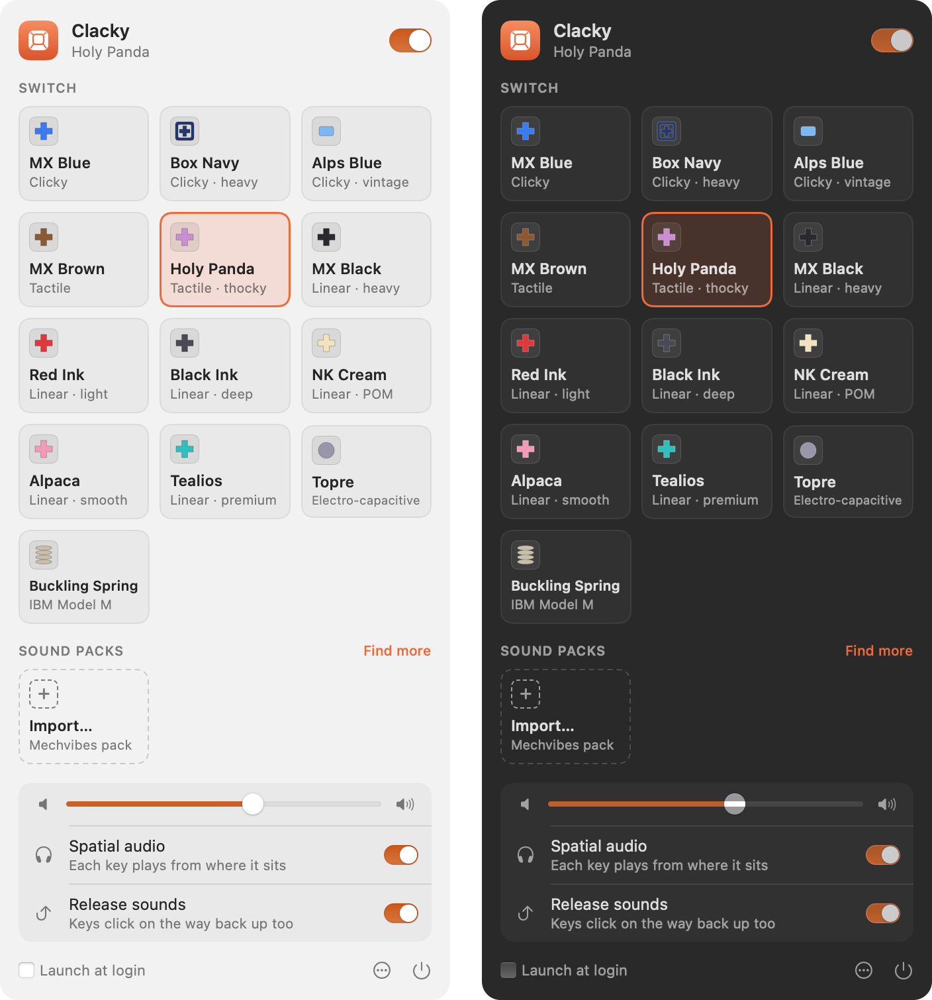

<p align="center"></p>

<h1 align="center">Clacky</h1>

<p align="center">
  Mechanical keyboard sounds for your Mac.<br>
  A tiny native menu bar app with real switch recordings and spatial audio.
</p>

<p align="center">
  <a href="https://github.com/Jam0r85/clacky/releases/latest/download/Clacky.dmg"><b>Download Clacky.dmg</b></a>
  &nbsp;·&nbsp; macOS 13 or later &nbsp;·&nbsp; Apple silicon and Intel &nbsp;·&nbsp; Free and open source
</p>

<p align="center"></p>

---

Love the sound of a mechanical keyboard but type on a MacBook? Clacky plays a real switch recording every time you press a key, and puts each key where it actually sits on the keyboard. Q clicks on your left, P on your right.

## Features

- **13 real switches.** Cherry MX Blue, Brown and Black. Holy Panda, Topre, Buckling Spring, NovelKeys Cream, Kailh Box Navy, Alps Blue, Gateron Red and Black Ink, Alpaca, and Turquoise Tealios.
- **Spatial audio.** Each key gets its own position, with the small timing and level differences your ears use to place a sound. It's best with headphones.
- **Feels like a real board.** Keys click going down and coming back up. The spacebar, Return, Backspace and Shift sound bigger, and each key has its own slightly different pitch. Holding a key doesn't machine-gun.
- **Sound packs.** Import thousands more from the [Mechvibes](https://mechvibes.com/sound-packs) community, as a `.zip` or a folder.
- **Light on your Mac.** It's a 3 MB app using about 17 MB of memory and no CPU while you're not typing. After 20 seconds idle it releases the audio hardware completely.
- **Private.** Clacky only checks *which* key you pressed, to pick a sound. It never records, stores or sends what you type, and it makes no network connections.

## Install

1. [Download Clacky.dmg](https://github.com/Jam0r85/clacky/releases/latest/download/Clacky.dmg), open it and drag **Clacky** into **Applications**.
2. Open Clacky. A keycap appears in your menu bar.
3. When macOS asks, allow **Input Monitoring**. This is how Clacky hears key presses. You can also turn it on later in **System Settings › Privacy & Security › Input Monitoring**.
4. Start typing.

Clacky is signed and notarized by Apple, so it opens without any security warnings.

## Using Clacky

Click the keycap in the menu bar to open the panel:

- **On/off switch** at the top. You can also **⌥-click** the menu bar icon to toggle Clacky without opening anything. The icon is filled when Clacky is on and outlined when it's off.
- **Switch:** pick a switch and you'll hear a quick left-to-right preview.
- **Sound packs:** import a Mechvibes pack, or right-click one to remove it.
- **Volume, Spatial audio and Release sounds**, plus **Launch at login** at the bottom.

## Sound packs

Click **Import…** in the panel and choose a pack's `.zip` file or folder. Packs are copied to `~/Library/Application Support/Clacky/Packs/`. Use **••• › Show Packs Folder** to manage them by hand.

Both Mechvibes formats work:

- **V2** packs use `definitions` keyed by `KeyboardEvent.code` (`KeyA`, `Space`…) with `timing: [[start, end], [start, end]]`. The second segment is the key-up sound.
- **V1** packs use `defines` keyed by iohook scan codes. With `key_define_type` set to `single`, each key is a `[start_ms, duration_ms]` slice of one `sound` file. With `multi`, each key has its own file.

Audio can be OGG, MP3, WAV, FLAC, AIFF or M4A. Keys a pack doesn't define borrow a sound from one that it does. Packs come from many people under different licenses, so check a pack's license before sharing it.

## Troubleshooting

**No sound when I type.** Make sure the switch at the top of the panel is on and the icon in the menu bar is filled. If the panel says *Allow Input Monitoring*, follow it. Also check the volume slider and your Mac's output volume.

**It's silent in password fields.** That's intended. macOS hides keystrokes from every app while a password field has focus.

**Clicks lag behind my typing.** Bluetooth headphones add their own delay, often 150 ms or more. Wired headphones and the built-in speakers are close to instant.

**Input Monitoring is on but nothing happens.** Turn Clacky off and on in System Settings › Privacy & Security › Input Monitoring. If that doesn't work, run this in Terminal and then open Clacky again:

```bash
tccutil reset ListenEvent io.github.jam0r85.clacky
```

## Building from source

You need Xcode 15 or later on macOS 13 or later.

```bash
git clone https://github.com/Jam0r85/clacky.git
cd clacky
make install    # builds a universal Clacky.app, copies it to /Applications and opens it
```

The build signs with your first *Apple Development* certificate if you have one, so the Input Monitoring permission survives rebuilds. Otherwise it signs ad-hoc. To choose a certificate, set `SIGN_IDENTITY`.

Other targets:

- `make demo` renders every switch typing a sentence to `build/demo/*.wav`, and prints loudness and stereo spread.
- `make icon` redraws the app icon.

### Releasing

`./scripts/release.sh 1.2.0 "What's new"` sets the version, builds, signs with your Developer ID, notarizes and staples the app and a DMG, tags the commit and publishes a GitHub release. The comments at the top of the script cover the one-off setup.

## How it works

| File | What it does |
|---|---|
| `Sources/ClackyCore/mixer.c` | The real-time voice mixer: a lock-free trigger queue, 32 voices, per-ear gain, fractional delay and low-pass. It never allocates or locks on the audio thread. |
| `Sources/Clacky/ClackEngine.swift` | The AVAudioEngine graph, binaural placement (Woodworth ITD, level difference and head shadow), idle suspend and output device changes. |
| `Sources/Clacky/KeyMonitor.swift` | A listen-only `CGEventTap` for key down, key up and modifier keys. It ignores auto-repeat. |
| `Sources/Clacky/KeyLayout.swift` | Maps Mac key codes to positions on an ANSI keyboard and to `KeyboardEvent.code` names. |
| `Sources/Clacky/SoundSource.swift` | Bundled recordings and Mechvibes packs, loudness-matched so every switch and key type sits at a similar level. |
| `Sources/Clacky/AppModel.swift` | App state and actions. |
| `Sources/Clacky/StatusItemController.swift`, `PanelView.swift` | The menu bar icon and its SwiftUI drop-down panel. |

## Credits

The switch recordings come from [kbsim](https://github.com/tplai/kbsim) by Thomas Lai and are used under the MIT License (see [`Resources/Switches/LICENSE-kbsim.md`](Resources/Switches/LICENSE-kbsim.md)). kbsim doesn't say who made the original recordings. If you made one of them, please [open an issue](https://github.com/Jam0r85/clacky/issues) so you can be credited.

## License

MIT. See [LICENSE](LICENSE).
