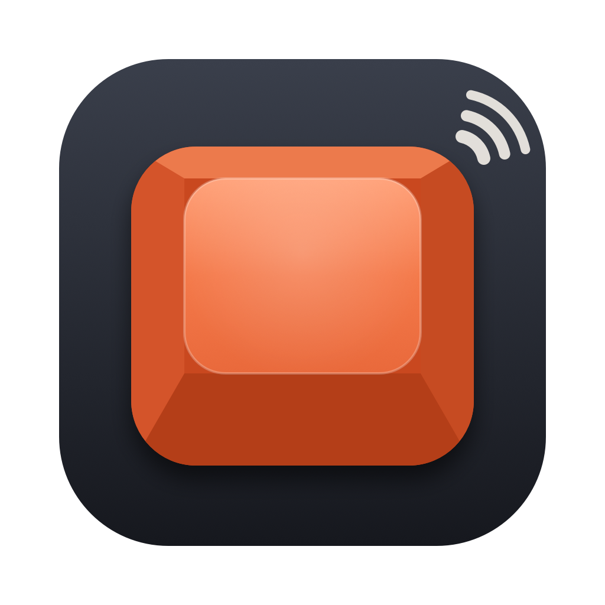

<p align="center"></p>

<h1 align="center">Clacky</h1>

<p align="center">Mechanical keyboard sounds for your Mac's built-in keyboard.<br>A tiny native menu bar app with spatial audio and 13 real switch recordings.</p>

---

- **Real switches**: Cherry MX Blue, Brown and Black, Holy Panda, Topre, Buckling Spring, NovelKeys Cream, Kailh Box Navy, Alps Blue, Gateron Red/Black Ink, Alpaca and Turquoise Tealios.
- **Spatial audio**: each key is placed where it sits on the keyboard, with per-ear level, timing and head-shadow filtering. Q comes from your left, P from your right. Best with headphones.
- **Press and release sounds**, with bigger sounds for the spacebar, Return, Backspace and Shift. Every key keeps its own slightly different pitch, like a real board.
- **Sound packs**: import any [Mechvibes](https://mechvibes.com/sound-packs) pack (V1 or V2, `.zip` or folder).
- **Light on your Mac**: about 2 MB on disk. The audio is mixed in C on the real-time thread with no allocations or locks. After 20 seconds without typing it releases the audio hardware, so it uses no audio CPU while you're idle. Turning it off removes the keyboard listener completely.

## Using it

Click the keycap in the menu bar to pick a switch, change the volume or toggle spatial audio and release sounds. **⌥-click** the icon to turn Clacky on or off instantly. The icon is filled when Clacky is listening and outlined when it's off.

On first launch macOS asks for **Input Monitoring** access (System Settings › Privacy & Security › Input Monitoring). Clacky needs it to hear key presses.

> **Privacy:** Clacky only looks at *which* key was pressed, to choose a sound and where to place it. It never records, stores or sends what you type, and it makes no network connections. It also gets no key events while a password field is focused (macOS Secure Input).

## Building

You need Xcode 15 or later (or its command line tools) on macOS 13+.

```bash
make app        # builds build/Clacky.app (universal)
make install    # copies it to /Applications and opens it
```

`scripts/build-app.sh` signs with your first *Apple Development* certificate if you have one, so the Input Monitoring permission survives rebuilds. Otherwise it signs ad-hoc, and macOS may ask for the permission again after each build. To pick a certificate yourself, set `SIGN_IDENTITY`. If the permission gets stuck after a rebuild:

```bash
tccutil reset ListenEvent io.github.jam0r85.clacky
```

Other targets: `make demo` renders every switch typing a sentence to `build/demo/*.wav` and prints loudness and stereo spread for each, with no permissions needed. `make icon` regenerates the app icon.

## Sound packs

Use **Sound Packs › Import Sound Pack…** and choose a pack's `.zip` or folder. Packs are copied to `~/Library/Application Support/Clacky/Packs/`.

Both Mechvibes formats work:

- **V2**: `definitions` keyed by `KeyboardEvent.code` (`KeyA`, `Space`…), with `timing: [[start, end], [start, end]]`. The second segment is the key-up sound.
- **V1**: `defines` keyed by iohook scan codes, with `key_define_type` set to `single` (`[start_ms, duration_ms]` slices of one `sound` file) or `multi` (one file per key).

Audio can be OGG, MP3, WAV, FLAC, AIFF or M4A. Keys a pack doesn't define borrow a consistent sound from one it does. Check each pack's own license before sharing it.

## How it works

| File | What it does |
|---|---|
| `Sources/ClackyCore/mixer.c` | Real-time voice mixer: a lock-free trigger queue, 32 voices, per-ear gain, fractional delay and low-pass. |
| `Sources/Clacky/ClackEngine.swift` | AVAudioEngine graph, binaural placement (Woodworth ITD + ILD + head shadow), idle suspend, device changes. |
| `Sources/Clacky/KeyMonitor.swift` | Listen-only `CGEventTap` for key down, key up and modifiers. Ignores auto-repeat. |
| `Sources/Clacky/KeyLayout.swift` | Maps Mac key codes to positions on an ANSI keyboard and to `KeyboardEvent.code` names. |
| `Sources/Clacky/SoundSource.swift` | Bundled recordings and Mechvibes packs, all loudness-matched. |
| `Sources/Clacky/AppController.swift` | Menu bar item and menu. |

## Credits

Switch recordings come from [kbsim](https://github.com/tplai/kbsim) by Thomas Lai and are used under the MIT License (see [`Resources/Switches/LICENSE-kbsim.md`](Resources/Switches/LICENSE-kbsim.md)). kbsim doesn't say who made the original recordings.

## License

MIT. See [LICENSE](LICENSE).
